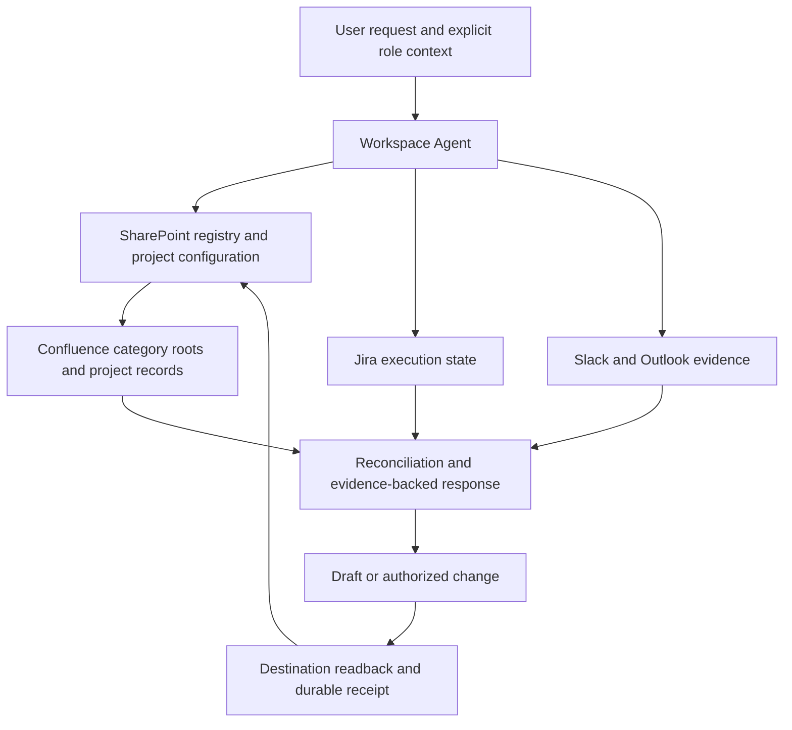

# Architecture

One reusable agent serves many projects. Each project supplies configuration, a domain runbook, approved sources, and its own durable records. The model interprets evidence; source systems and platform controls enforce access. These instruction files are not a deterministic transaction engine.

## Ownership

| Layer | Owns | Does not establish |
| --- | --- | --- |
| Jira or configured tracker | Assigned execution state | Acceptance of every project exit criterion |
| Confluence | Shared narrative, registers, evidence links, reports | A second editable copy of tracker fields |
| SharePoint | Configuration, pointers, state, provenance, action history | Permission to bypass platform controls |
| Communication sources | Original messages and meeting records | Automatic commitment from informal language |
| Personal ChatGPT Project | Role context and working preferences | Authoritative shared facts or automatic memory transfer |
| GitHub starter | Reusable setup and examples | Live project state or hosted deployment |

## Optional personalized workspace

A team can test using the shared agent from separate personal ChatGPT Projects. This is an integration hypothesis until invocation, available context, connector identity, and isolation are verified in that workspace. Explicitly pass the registered project ID, role, task, and relevant context. Fall back to a direct agent conversation when invocation or context transfer is unavailable. Do not infer visibility of other conversations or files.

## Evidence flow

Resolve one project → load current records → discover approved evidence → reconcile owning records → prepare the report → perform authorized writes → verify each destination → advance verified pointers. Focused questions may stop after the relevant evidence read.

A report manifest pins the versions and coverage that produced it. A failed folder listing does not prove a project is missing. A timed-out write does not prove it failed. An interrupted run resumes by reconciling destinations, not blindly replaying creates or sends.
